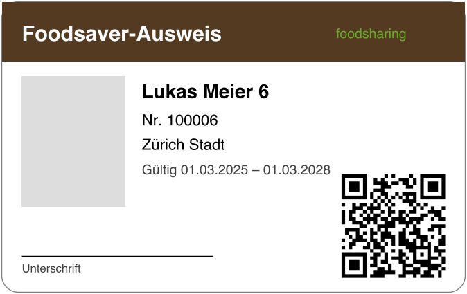

# Passport layout (T16, for admin approval)

Rendered by `PassportPdfRenderer` (OpenPDF); `PassportPdfRendererTest` writes `server/target/passport-sample.png`
(copied here as `passport-sample.png`).

## Card (ID-1, 85.6 × 54 mm)

| Element | Position / size | Content |
|---|---|---|
| Frame | full card, rounded 3 mm, grey 0.5 pt | — |
| Header band | top, 11 mm high, brown `#533a20` | title (Helvetica Bold 11 pt, white) in the user's language: Foodsaver-Ausweis / Foodsaver passport / Foodsaver-Uswiis / Carte de foodsaver / Tessera foodsaver; "foodsharing" (7 pt, green `#64ae24`) on the right |
| Photo | left, 19 × 24 mm, 4 mm from the edge | grey placeholder (avatars are not embedded yet) |
| Name | right of the photo, Helvetica Bold 10 pt | first + last name, else display name |
| Number | below, 8 pt | "Nr." + foodsaver number |
| Region | below, 8 pt | home region name |
| Validity | below, 7 pt, dark grey | "Gültig dd.MM.yyyy – dd.MM.yyyy" (start of validity – start + 3 years) |
| Signature | bottom left, 35 mm line, label 6 pt | "Unterschrift" (localised) |
| QR code | bottom right, 19 × 19 mm, vector modules (zxing, error correction M) | `app.base-url/users/{userId}` |

## Sheets

- `CARD`: one card per page (page size = card size), for the own download and single prints.
- `A4`: 2 columns × 5 rows of cards centred on the page (no gaps), light-grey cut marks at every card corner; 10
  cards per page, further pages as needed (11 cards → 2 pages).

## Open points for approval

- Fonts: standard Helvetica (WinAnsi covers de/en/gws/fr/it); embedding Noto Sans needs the font file in the repo.
- Photo: placeholder until avatars are stored server-side; then the avatar is drawn into the photo area.
- Logo: text only ("foodsharing"); the official logo can replace it once the asset is available.
